# Turnpike Analyst — Enterprise System Architecture & Design

> **Single source tree, three production repositories.**  
> `turnpike-frontend` (Public Website & Intern Portal) · `turnpike-admin` (Super Admin & Operations Console) · `turnpike-backend` (FastAPI + MongoDB API) · `packages/shared` (Shared Design System & API Client)

This document is the complete **A-to-Z system architecture** for the Turnpike Analyst platform. It maps every user-facing route on the public website, every role-gated screen in the admin and super-admin console, the internal 4-layer backend execution model, the dual-source (GitHub + `.zip` archive) AI verification pipeline, certificate rendering, security boundaries, data schemas, and technology stack choices.

---

## Table of Contents

1. [System Context](#1-system-context)
2. [Container & Deployment Topology](#2-container--deployment-topology)
3. [Monorepo & Multi-Repo Publishing Structure](#3-monorepo--multi-repo-publishing-structure)
4. [User Access — Public Website (`turnpike-frontend`)](#4-user-access--public-website-turnpike-frontend)
5. [Admin & Super Admin Access (`turnpike-admin`)](#5-admin--super-admin-access-turnpike-admin)
6. [Backend Architecture (`turnpike-backend`)](#6-backend-architecture-turnpike-backend)
7. [Request Lifecycle & Token Refresh](#7-request-lifecycle--token-refresh)
8. [Authentication & Authorisation](#8-authentication--authorisation)
9. [Super Administrator Lifecycle](#9-super-administrator-lifecycle)
10. [Internship Programme & Dual-Source Verification](#10-internship-programme--dual-source-verification)
11. [AI Provider Fallback Chain](#11-ai-provider-fallback-chain)
12. [Grounded Support Assistant](#12-grounded-support-assistant)
13. [Certificate Rendering & Public Verification](#13-certificate-rendering--public-verification)
14. [File Storage & Upload Security](#14-file-storage--upload-security)
15. [Data Model & MongoDB Collections](#15-data-model--mongodb-collections)
16. [Complete API Surface](#16-complete-api-surface)
17. [Frontend & Admin UI Architecture](#17-frontend--admin-ui-architecture)
18. [Security Model](#18-security-model)
19. [Failure Modes & Resilience](#19-failure-modes--resilience)
20. [Complete Technology Stack](#20-complete-technology-stack)
21. [Operations & Extending the System](#21-operations--extending-the-system)

---

## 1. System Context

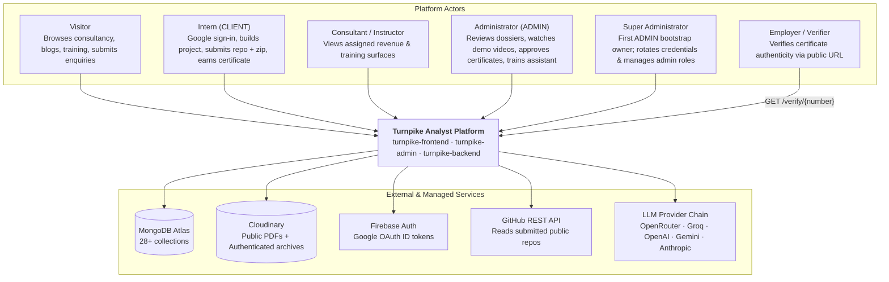

| Core Capability | Primary Users | Outcome |
|---|---|---|
| **Enterprise Consultancy Showcase** | Visitors, Prospects | Explore 15+ service domains, industries, JAMES WEBB & Agent P8 solutions, training courses, and capture leads/calls |
| **Free Verified Internship Programme** | Interns, Admins, Employers | End-to-end project enrollment (1–3 months), dossier + `.zip` + GitHub repo verification, AI claim checks, human demo audit, PDF certificate |
| **Grounded Support Assistant** | Visitors, Interns, Admins | Knowledge-base-grounded Q&A widget with unanswered question backlog for continuous admin training |

---

## 2. Container & Deployment Topology

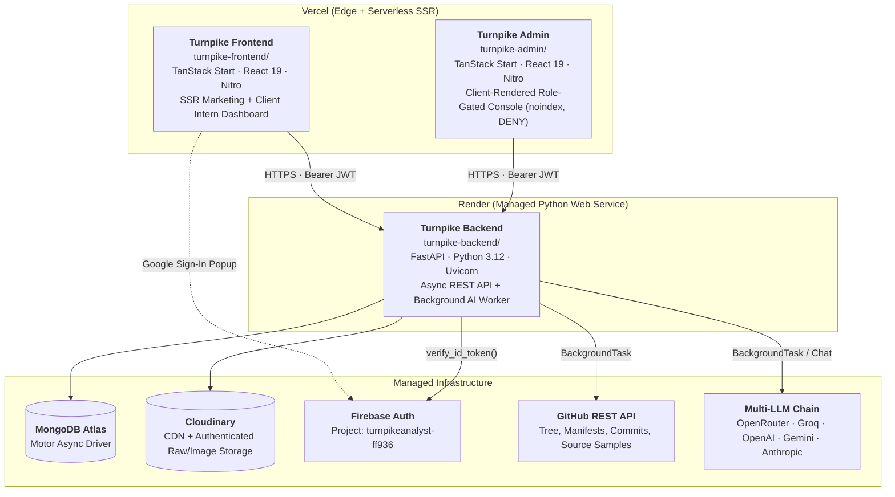

### Architectural Rationale
- **One API service, not microservices:** The internship review pipeline, certificate renderer, CMS, and support assistant share MongoDB collections, auth guards, and the LLM provider chain. A single FastAPI service eliminates distributed deployment drift while staying async.
- **Two separate frontend apps (`turnpike-frontend` & `turnpike-admin`):** The public site requires crawlable SSR (`X-Frame-Options: SAMEORIGIN`), while the admin console requires strict client-only rendering (`ssr: false`), `X-Robots-Tag: noindex, nofollow`, and `X-Frame-Options: DENY`. Keeping them separate guarantees admin console code never ships in the public bundle.

---

## 3. Monorepo & Multi-Repo Publishing Structure

The monorepo is the **single source of truth**. `scripts/publish-repos.sh` stages each deployable into its dedicated public GitHub repository, attaches shared packages and architecture docs, scans every file for leaked credentials, and pushes cleanly.

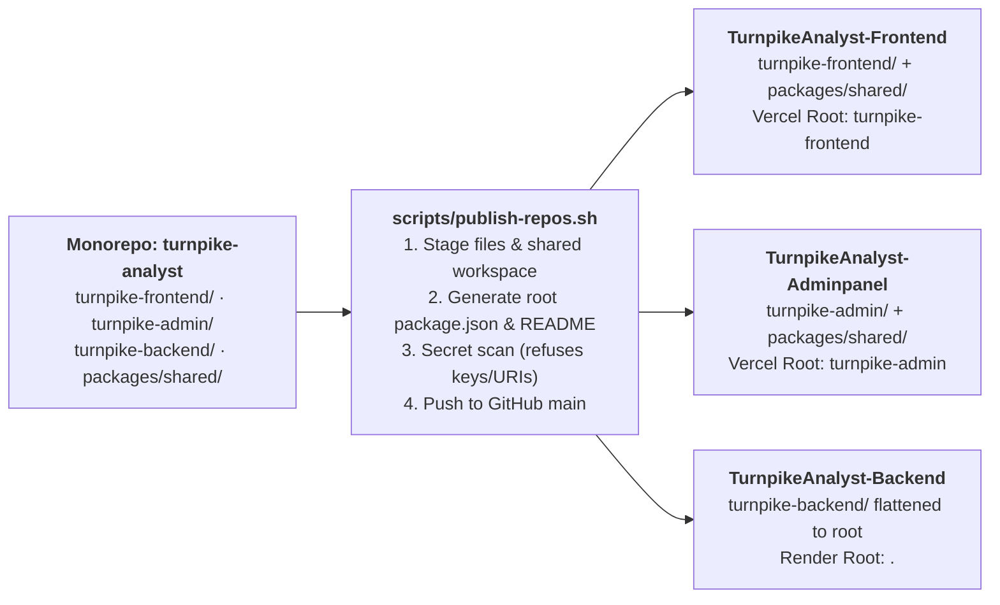

```
turnpike-analyst/
├── turnpike-frontend/                  # Public website + Intern portal (Vercel)
│   ├── src/
│   │   ├── routes/
│   │   │   ├── __root.tsx              # Document shell, theme, query provider
│   │   │   ├── _site.tsx               # SiteHeader, SiteFooter, FloatingActions, SupportChat
│   │   │   └── _site/                  # 22 public & intern routes
│   │   ├── components/
│   │   │   ├── site/                   # Navigation, Hero, Services, SupportChat, WaveDivider
│   │   │   ├── internship/             # DossierForm (4 steps + .zip), SubmissionSummary, GoogleButton
│   │   │   └── shared/                 # BookCallDialog
│   │   ├── content/                    # Static service/product/training marketing data
│   │   ├── server.ts · start.ts · router.tsx
│   │   ├── styles.css                  # Tailwind v4 entry (@source self + shared)
│   │   └── vercel.json                 # Nitro Vercel preset build & headers
│   └── README.md
│
├── turnpike-admin/                     # Super Admin & Operations Console (Vercel)
│   ├── src/
│   │   ├── routes/
│   │   │   ├── __root.tsx              # Admin HTML shell
│   │   │   ├── index.tsx               # Redirects / -> /admin
│   │   │   ├── login.tsx               # Staff email/password login
│   │   │   ├── admin.tsx               # Role gate (ADMIN check) + DashboardLayout
│   │   │   └── admin/                  # 27 console pages
│   │   ├── components/layout/          # AppSidebar, AppTopbar, DashboardLayout
│   │   ├── features/                   # Domain CRUD modal dialogs
│   │   ├── constants/navigation.ts     # Role-filtered sidebar & route titles
│   │   ├── server.ts · start.ts · router.tsx
│   │   ├── styles.css
│   │   └── vercel.json                 # X-Frame-Options: DENY, noindex
│   └── README.md
│
├── packages/shared/                    # Workspace package: @turnpike/shared
│   └── src/
│       ├── components/ui/              # 47 Radix-based UI primitives
│       ├── components/premium/         # PageHeader, DataTable, MermaidDiagram, States
│       ├── components/effects/         # AuroraBackground, CustomCursor, ScrollEffects
│       ├── api/
│       │   ├── client.ts               # Axios instance, Bearer injection, 401 refresh interceptor
│       │   └── services/               # 14 domain API clients
│       ├── hooks/                      # use-auth · use-api · use-internship · use-public-api · use-prefs
│       ├── lib/                        # firebase.ts · security-headers.ts · error-capture.ts
│       ├── store/auth-store.ts         # Zustand persisted session (turnpike.auth.v1)
│       ├── types/                      # TypeScript mirrors of backend Pydantic schemas
│       └── styles/tokens.css           # Light/dark oklch design system
│
├── turnpike-backend/                   # Enterprise FastAPI + MongoDB API (Render)
│   ├── app/
│   │   ├── main.py                     # App, lifespan, 12 index builders, 15 routers, /uploads
│   │   ├── core/                       # config.py (Pydantic Settings), security.py (JWT/bcrypt)
│   │   ├── api/
│   │   │   ├── deps.py                 # get_current_user, _active_user, _admin, require_roles
│   │   │   └── v1/                     # 15 FastAPI domain routers
│   │   ├── schemas/                    # Pydantic v2 request/response contracts
│   │   ├── crud/                       # Pure Motor async MongoDB operations
│   │   ├── services/                   # llm.py, ai_review.py, github_repo.py, source_archive.py,
│   │   │                               # certificate_render.py, storage.py
│   │   ├── models/enums.py             # UserRole, InternshipStatus, EnrollmentMode, etc.
│   │   └── db/mongodb.py               # AsyncIOMotorClient lifecycle
│   ├── scripts/                        # seed_data, seed_internship, seed_chatbot, migrate_database
│   ├── requirements.txt
│   └── README.md
│
├── scripts/publish-repos.sh            # Monorepo -> 3 GitHub deployment repos
├── render.yaml                         # Render blueprint
├── ARCHITECTURE.md                     # This system design document
├── DEPLOYMENT.md                       # Production deployment runbook
└── README.md                           # Monorepo overview
```

---

## 4. User Access — Public Website (`turnpike-frontend`)

### What Visitors & Interns See (22 Routes under `_site/`)

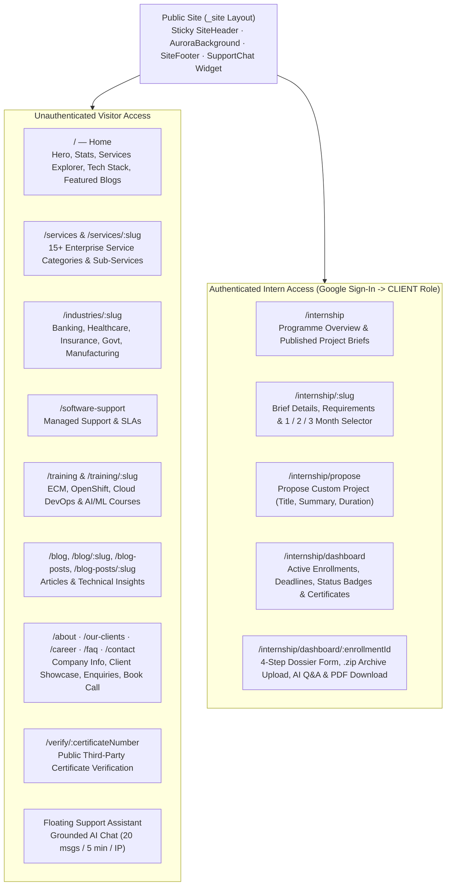

### Complete Website Route Inventory (`turnpike-frontend/src/routes/_site/`)

| Route | Access | Purpose |
|---|---|---|
| `/` | Public | Landing page, services explorer, proprietary tools, stats, blogs |
| `/services` & `/services/$slug` | Public | Enterprise service catalogue & individual service details |
| `/industries/$slug` | Public | Industry-specific solutions & client groupings |
| `/software-support` | Public | Managed enterprise software support offerings |
| `/training` & `/training/$slug` | Public | Training courses & curriculum details |
| `/blog`, `/blog/$slug`, `/blog-posts`, `/blog-posts/$slug` | Public | Blog catalogue & article reader |
| `/about`, `/our-clients`, `/career`, `/faq`, `/contact` | Public | Company profile, global partners, careers, FAQs, contact & call booking |
| `/verify/$certificateNumber` | Public | Instant certificate validity check for employers (no login required) |
| `/internship` | Public | Internship programme landing & available project tracks |
| `/internship/$slug` | Public / Google Auth | Project brief detail + duration selection (`1`, `2`, `3` months) + enroll |
| `/internship/propose` | Google Auth (`CLIENT`) | Custom project proposal + duration selection + enroll |
| `/internship/dashboard` | Google Auth (`CLIENT`) | Intern personal dashboard listing enrollments & issued certificates |
| `/internship/dashboard/$enrollmentId` | Google Auth (Owner) | 4-step dossier submission, `.zip` upload, follow-up Q&A, status polling, PDF download |

---

## 5. Admin & Super Admin Access (`turnpike-admin`)

### Role Gate & Console Architecture (27 Routes under `/admin`)

Every `/admin/*` page sits behind `admin.tsx` (`ssr: false`). Unauthenticated visitors redirect to `/login`; authenticated non-admin accounts (`CLIENT`) see an explicit access explanation and sign-out button before any admin API call is made; `ADMIN` (including Super Admin), `CONSULTANT`, and `INSTRUCTOR` see only the sidebar sections matching their role.

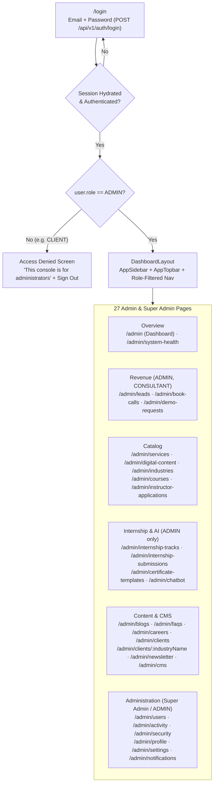

### Role & Permission Matrix

| Console Section / Surface | Super Admin / `ADMIN` | `CONSULTANT` | `INSTRUCTOR` | `CLIENT` (Intern) |
|---|---|---|---|---|
| **Dashboard & Profile / Settings** | Full Access | Read / Own | Read / Own | Blocked at Gate |
| **System Health (`/admin/system-health`)** | Full Access | Hidden | Hidden | Blocked |
| **Leads, Book Calls, Demo Requests** | Full CRUD | View & Update | Hidden | Blocked |
| **Services, Digital Content, Industries, Courses** | Full CRUD | Full CRUD | Full CRUD | Blocked |
| **Instructor Applications** | Full Access | Full Access | Full Access | Blocked |
| **Internship Tracks, Submissions, Decisions & Certificates** | Full Access | Hidden | Hidden | Blocked |
| **Support Assistant Knowledge, Unanswered & Behaviour** | Full Access | Hidden | Hidden | Blocked |
| **User Management & Role Elevation (`/admin/users`)** | Full CRUD | Hidden | Hidden | Blocked |
| **Activity Logs (`/admin/activity`)** | Full Audit | Hidden | Hidden | Blocked |
| **Sign-in & Security (`/admin/security`)** | Own Credentials | Hidden | Hidden | Blocked |

---

## 6. Backend Architecture (`turnpike-backend`)

### Four-Layer Dependency Rule

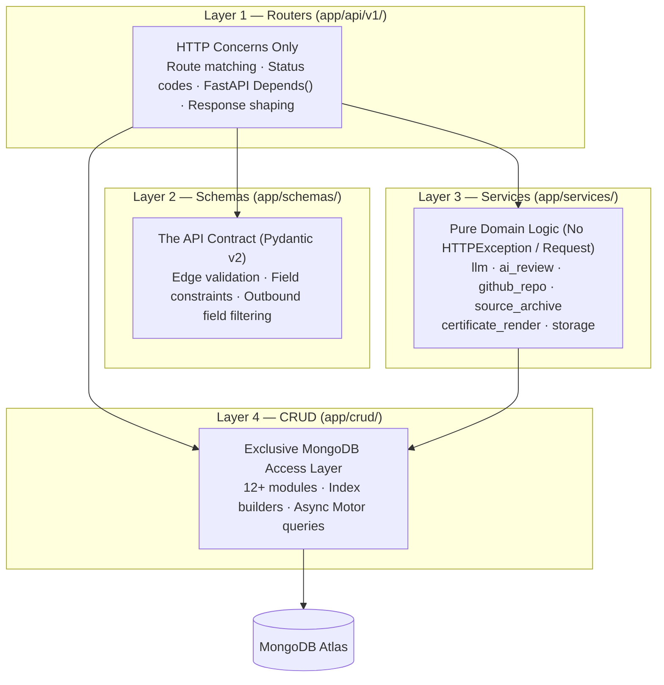

- **Strict Database Boundary:** Only `app/crud/` imports or executes Motor queries, guaranteeing collection names and indexes stay centralized.
- **HTTP-Free Services:** `app/services/*` raise domain exceptions (`ReviewUnavailable`, `RepoAccessError`, `ArchiveError`, `StorageError`, `CertificateRenderError`), allowing identical execution inside HTTP requests and detached `BackgroundTasks`.

### Startup Lifespan Sequence (`app/main.py`)

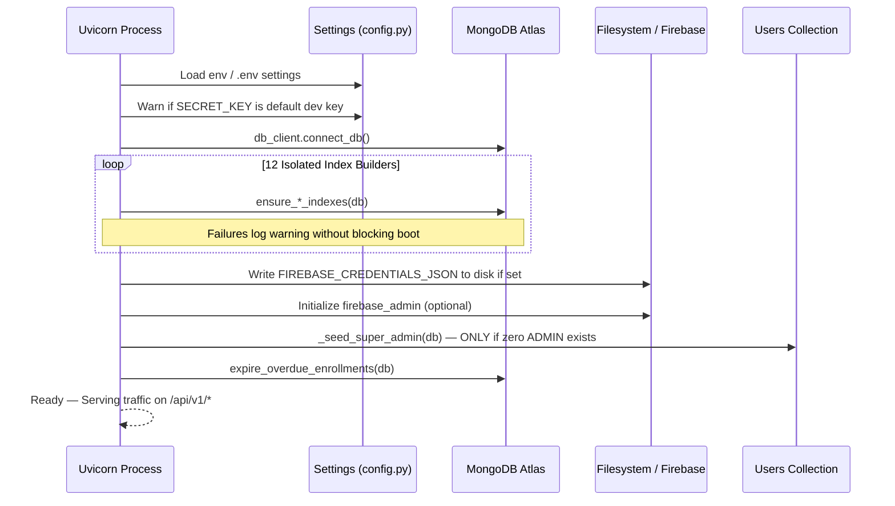

---

## 7. Request Lifecycle & Token Refresh

### Authenticated Admin Request Lifecycle

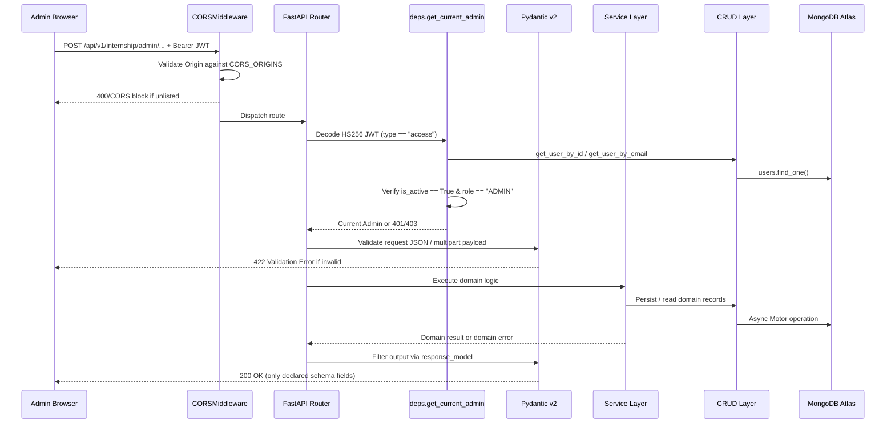

### Shared Axios Silent JWT Refresh Loop (`packages/shared/src/api/client.ts`)

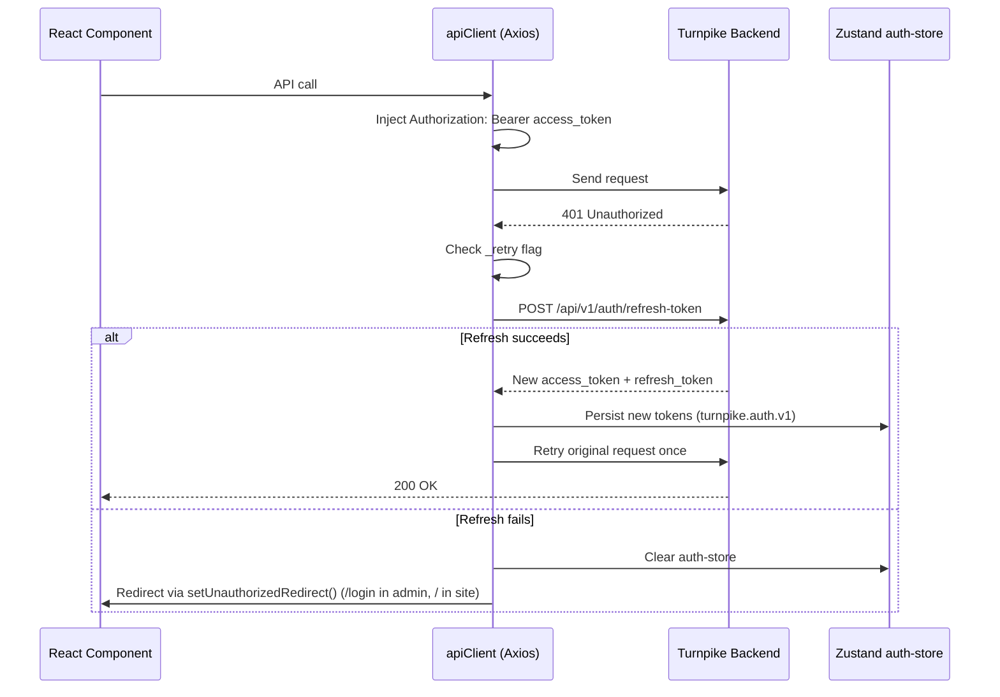

---

## 8. Authentication & Authorisation

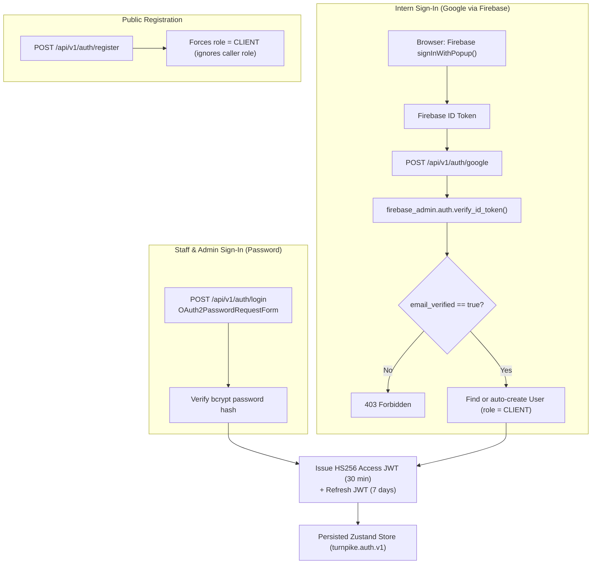

---

## 9. Super Administrator Lifecycle

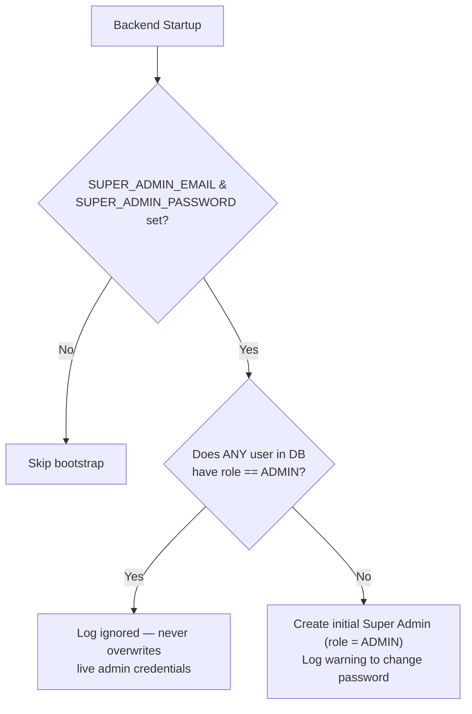

### Changing Super Admin Credentials (`/admin/security` -> `POST /api/v1/account/credentials`)

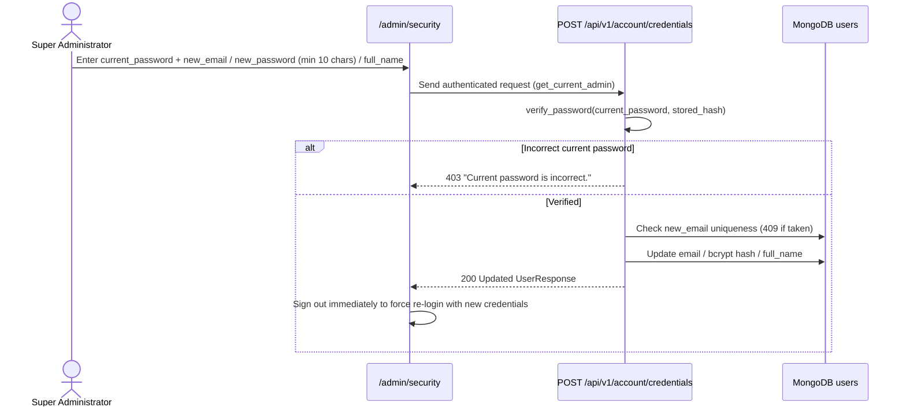

---

## 10. Internship Programme & Dual-Source Verification

### Enrollment Lifecycle State Machine

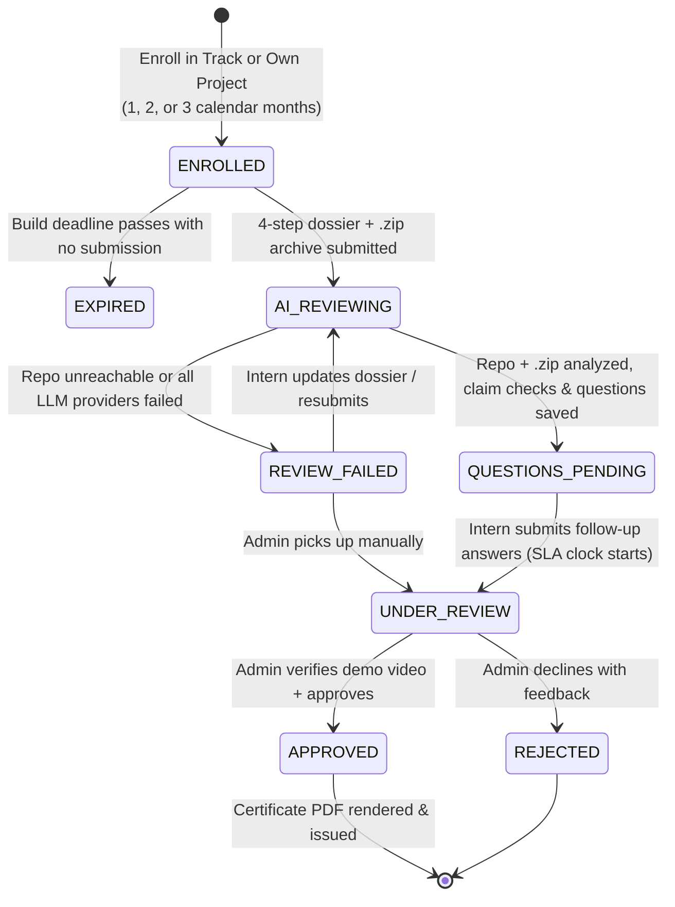

### 4-Step Dossier + Mandatory `.zip` Archive & Dual-Source AI Review

Every intern submission combines **public GitHub code** with a **direct `.zip` source archive upload** (`source_archive.py`), preventing empty-repo fraud or bait-and-switch links:

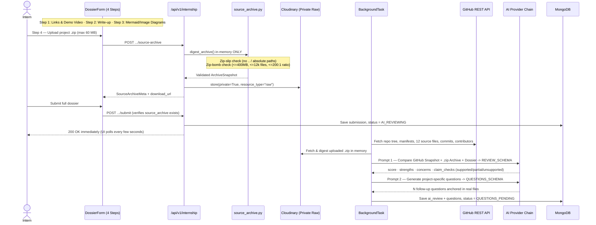

### Admin Review & Human Demo Verification (`turnpike-admin`)

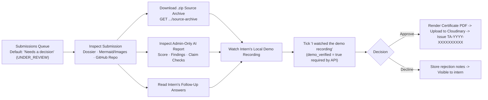

---

## 11. AI Provider Fallback Chain

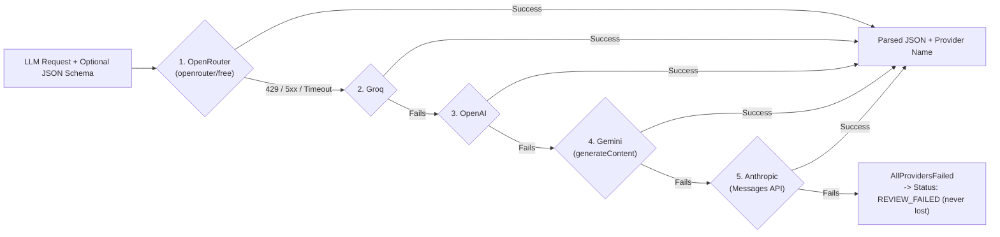

- **Configured Chains:**
  - `AI_REVIEW_PROVIDERS=openrouter,groq,openai,gemini,anthropic`
  - `CHATBOT_PROVIDERS=groq,openrouter,openai` (Gemini omitted from live chat due to 230–290s free-tier latency)
- **Reasoning Model Token Floor:** Responses apply a minimum 1024-token budget so reasoning models do not exhaust tokens before producing JSON.
- **Silent Key Pruning:** Any provider without an API key configured is skipped automatically.

---

## 12. Grounded Support Assistant

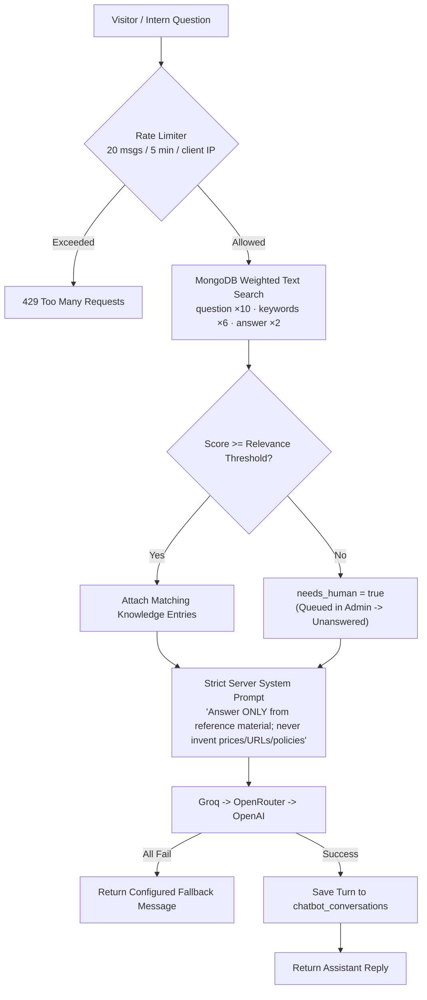

---

## 13. Certificate Rendering & Public Verification

```mermaid
sequenceDiagram
    actor A as Administrator
    participant AD as /admin/certificate-templates
    participant API as Turnpike Backend
    participant PIL as Pillow Renderer
    participant CL as Cloudinary
    participant DB as MongoDB

    rect rgb(38, 46, 56)
        Note over A,DB: Template Setup (Once per Design)
        A->>AD: Upload background artwork (PNG/JPEG/WebP)
        AD->>API: POST /api/v1/internship/admin/templates
        API->>CL: Store public artwork + measure width/height
        A->>AD: Drag fields (recipient_name, project_title, duration, issued_on, certificate_number)
        API->>DB: Save field coordinates, fonts, colors & max_width
    end

    rect rgb(38, 46, 56)
        Note over A,DB: Certificate Issuance (Per Approval)
        A->>API: POST .../decide (decision=APPROVED, demo_verified=true)
        API->>DB: Load active certificate template
        API->>CL: Fetch background artwork
        API->>PIL: Stamp dynamic fields (auto-shrink long names to fit max_width)
        API->>PIL: Generate PDF bytes + ID TA-YYYY-10CHARS (no O/0/I/1)
        API->>CL: Store public PDF (raw)
        API->>DB: Insert certificates record + link enrollment
    end
```

Employers verify any certificate without signing in at `/verify/<certificateNumber>` -> `GET /api/v1/internship/certificates/verify/{certificate_number}`.

---

## 14. File Storage & Upload Security

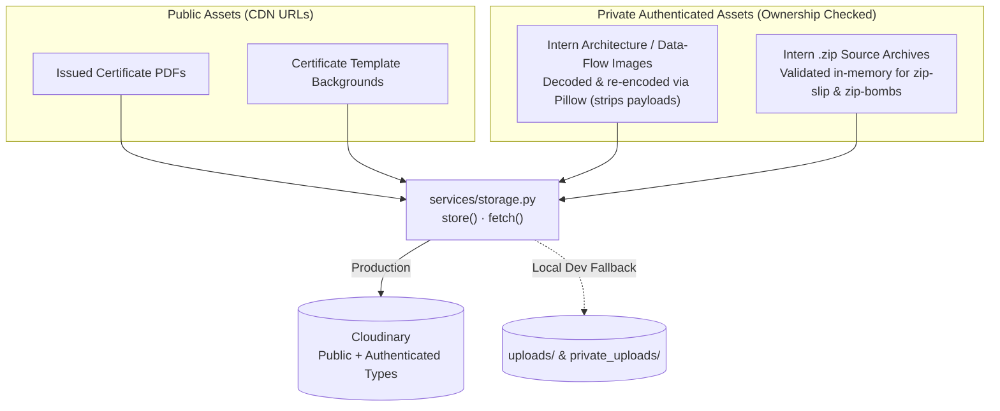

---

## 15. Data Model & MongoDB Collections

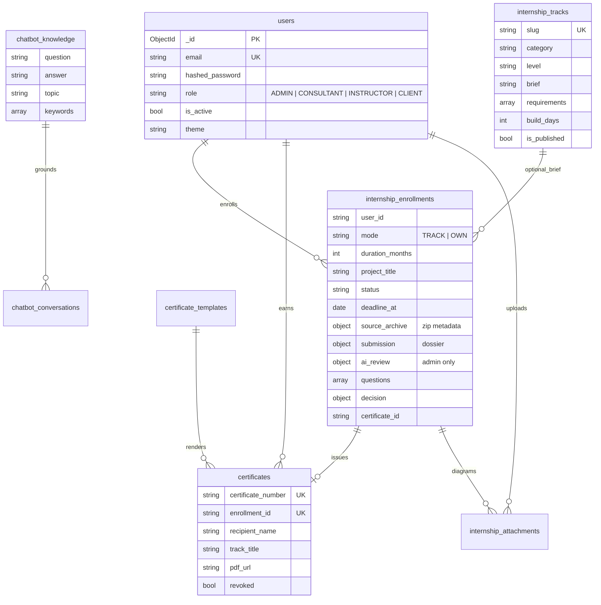

### Key Collections & Indexes

| Domain | Collections | Critical Indexes |
|---|---|---|
| **Identity & Audit** | `users`, `activity_logs` | Unique `users.email` |
| **Consultancy & Content** | `services`, `industries`, `products`, `blogs`, `blogs_and_articles`, `faqs`, `courses_and_training`, `consultants`, `cms_assets`, `stats`, `awards`, `testimonials` | Unique slugs & category keys |
| **Revenue Capture** | `leads`, `appointments_and_leads`, `newsletters` | Status & created_at sorting |
| **Internship & Certificates** | `internship_tracks`, `internship_enrollments`, `internship_attachments`, `internship_settings`, `certificate_templates`, `certificates` | Partial unique `(user_id, track_id)` where `track_id` is string; unique `certificate_number`; unique `enrollment_id` |
| **Support Assistant** | `chatbot_knowledge`, `chatbot_conversations`, `chatbot_settings` | Weighted text index (`question: 10`, `keywords: 6`, `answer: 2`) |

---

## 16. Complete API Surface

Interactive OpenAPI & ReDoc documentation is served at `/docs` and `/redoc`.

| Router Prefix | Auth Guard | Responsibilities |
|---|---|---|
| `/api/v1/auth` | Public / Refresh | `POST /register` (forces `CLIENT`), `/login`, `/google`, `/refresh-token` |
| `/api/v1/account` | `get_current_admin` | `GET /me`, `POST /credentials` (current-password verified rotation) |
| `/api/v1/services` | Public / Admin | 15+ enterprise service categories, sub-services & proprietary tools |
| `/api/v1/content` | Public / Admin | Industries, products, stats, awards, testimonials, FAQs |
| `/api/v1/blogs` | Public / Admin | Blog posts & technical articles |
| `/api/v1/training` | Public / Admin | Training courses & instructor applications |
| `/api/v1/leads` | Public / Staff | Contact enquiries, book-a-call, demo requests |
| `/api/v1/newsletter` | Public / Admin | Newsletter subscriptions |
| `/api/v1/consultants` | Public / Admin | Consultant profiles & scheduling |
| `/api/v1/cms` | Public / Admin | CMS media assets & digital content |
| `/api/v1/users` | `ADMIN` | User listing, creation, role grants/revokes, deletion |
| `/api/v1/activity-logs` | `ADMIN` | Administrative audit trail |
| `/api/v1/internship` | Public / `CLIENT` | Public tracks, enroll, dossier submit, `.zip` upload/download, diagram attachments, Q&A, `/certificates/verify/{n}` |
| `/api/v1/internship/admin` | `ADMIN` | Settings, track CRUD, submission queue, AI reports, approve/decline, certificate templates & preview |
| `/api/v1/chatbot` | Public / `ADMIN` | Public `/chat` & `/settings`, admin knowledge CRUD, unanswered backlog, persona settings |

---

## 17. Frontend & Admin UI Architecture

```mermaid
graph TB
    subgraph FE["turnpike-frontend (SSR + Client)"]
        F_ROOT["__root.tsx — Head, Fonts, QueryClient, Toaster"]
        F_SITE["_site.tsx — Header, Footer, SupportChat, FloatingActions"]
        F_PAGES["22 Routes (Marketing SSR + Intern Dashboard ssr:false)"]
        F_ROOT --> F_SITE --> F_PAGES
    end

    subgraph AD["turnpike-admin (Client-Rendered Console)"]
        A_ROOT["__root.tsx — noindex, frame-denied"]
        A_GATE["admin.tsx — Role Gate (ADMIN check)"]
        A_SHELL["DashboardLayout — Sidebar, Topbar"]
        A_PAGES["27 Console Routes (ssr: false)"]
        A_ROOT --> A_GATE --> A_SHELL --> A_PAGES
    end

    SH["packages/shared (@turnpike/shared)<br/>47 Radix UI Primitives · Axios Client · Zustand Auth<br/>TanStack Query Hooks · oklch Design Tokens"]

    SH -.-> F_SITE
    SH -.-> A_SHELL
```

---

## 18. Security Model

| Threat / Vector | Implemented Control |
|---|---|
| **Privilege Escalation on Register** | `/auth/register` and `/auth/google` hardcode `role = CLIENT` regardless of payload |
| **Unverified Google Email** | `firebase_admin.auth.verify_id_token` enforces `email_verified == true` |
| **Admin Console Access by Non-Admin** | `admin.tsx` blocks non-`ADMIN` before rendering; backend enforces `get_current_admin` on all admin endpoints |
| **Bootstrap Backdoor** | `SUPER_ADMIN_*` seeding runs only when zero `ADMIN` accounts exist in MongoDB |
| **Unattended Console Hijack** | `/account/credentials` requires `current_password` verification |
| **Zip-Bomb / Zip-Slip Uploads** | `source_archive.py` validates paths (`..`, absolute, drive letters) and metadata limits (60 MB / 400 MB / 12k files / 200:1 ratio) purely in memory without writing to disk |
| **Stored XSS via Diagrams** | Only PNG/JPEG/WebP allowed (SVG rejected); Pillow decodes & re-encodes pixels; served only via auth-checked route with `nosniff` + CSP |
| **ID Enumeration** | Non-owned intern records & attachments return `404` instead of `403` |
| **Certificate Enumeration** | 10-char look-alike-free random token (`TA-YYYY-XXXXXXXXXX`) |
| **Secret Leakage in Repos** | `.env` & service accounts gitignored; `publish-repos.sh` aborts on credential patterns |

---

## 19. Failure Modes & Resilience

| Failure Scenario | System Behaviour |
|---|---|
| **Single LLM provider fails / 429s** | Automatically falls through to next provider in chain |
| **All LLM providers fail** | Enrollment parks safely in `REVIEW_FAILED` with stored diagnostic; admin can review manually or intern can resubmit |
| **Private / broken GitHub repo** | Marked `REVIEW_FAILED` with actionable message to intern |
| **Cloudinary outage** | Upload fails fast with `502`; no dangling MongoDB metadata written |
| **Firebase credentials absent** | Only `/auth/google` returns `503`; staff login, CMS, and public site remain online |
| **MongoDB unreachable at boot** | Index builders log warnings individually; server still boots |
| **Approval without active template** | API returns `409 Conflict` explaining an active template is required |

---

## 20. Complete Technology Stack

| Layer | `turnpike-frontend` & `turnpike-admin` | `packages/shared` | `turnpike-backend` |
|---|---|---|---|
| **Core Runtime & Language** | TypeScript 5.8 · React 19.2 · Bun 1.4+ | TypeScript 5.8 · React 19.2 | Python 3.12 · FastAPI 0.110+ · Uvicorn |
| **Routing & SSR** | TanStack Start · TanStack Router · Nitro (`vercel` preset) | TanStack Router types | FastAPI APIRouter (`/api/v1`) |
| **Build Tooling** | Vite 8 · `vite-tsconfig-paths` · ESLint · Prettier | Workspace source alias (`@turnpike/shared`) | `pip` + `requirements.txt` |
| **Styling & Design System** | Tailwind CSS v4 · `@tailwindcss/typography` · `tw-animate-css` | `oklch` CSS variables (light & dark) · `tailwind-merge` · `class-variance-authority` | — |
| **UI, Icons & Animation** | Lucide React · Motion (`motion`) · Recharts (Admin analytics) | 47 Radix UI primitives (`shadcn`) · GSAP · Lenis · `cmdk` · `vaul` · `embla-carousel-react` · `sonner` | — |
| **Diagrams & Rich Content** | `mermaid` 12.3 · `react-markdown` · `rehype-raw` | `MermaidDiagram` renderer | Mermaid source validation & AI parsing |
| **State & Validation** | TanStack React Query v5 · React Hook Form · Zod 3.24 | Axios (`apiClient`) · Zustand v5 (persisted auth) | Pydantic v2 · `pydantic-settings` · `email-validator` |
| **Database & Storage** | — | — | MongoDB Atlas · Motor (async) · Cloudinary · Pillow (image/PDF) |
| **Auth & Security** | Firebase Web SDK v12 (`signInWithPopup`) | Shared `firebase.ts` & `security-headers.ts` | `python-jose` (JWT HS256) · `passlib[bcrypt]` · `firebase-admin` |
| **AI & External APIs** | — | — | `httpx` async client -> OpenRouter, Groq, OpenAI, Gemini, Anthropic, GitHub REST |

---

## 21. Operations & Extending the System

### Local Development

```bash
# 1. Start Turnpike Backend (port 8000)
cd turnpike-backend
python -m venv .venv && ./.venv/bin/pip install -r requirements.txt
cp .env.example .env
./.venv/bin/uvicorn app.main:app --reload --port 8000

# 2. Start Turnpike Frontend (:3000) and Turnpike Admin (:3001) from monorepo root
bun install
bun run dev:frontend
bun run dev:admin
```

### Publishing to the Three GitHub Repositories

```bash
./scripts/publish-repos.sh --dry-run          # Stage & secret-scan locally
./scripts/publish-repos.sh                    # Push all 3 repos
./scripts/publish-repos.sh turnpike-backend   # Push a single target
```

See [DEPLOYMENT.md](./DEPLOYMENT.md) for Vercel, Render, MongoDB Atlas, Cloudinary, and Firebase production setup.
