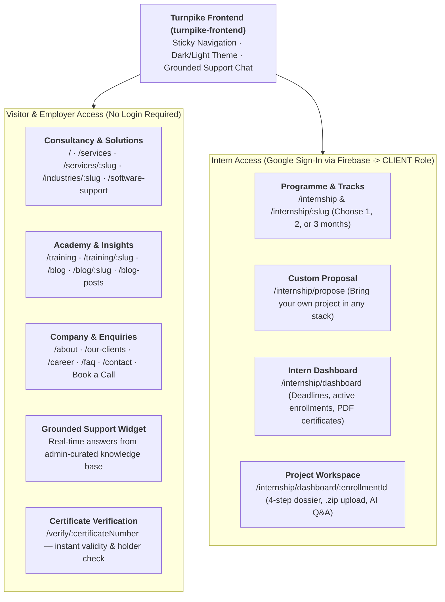
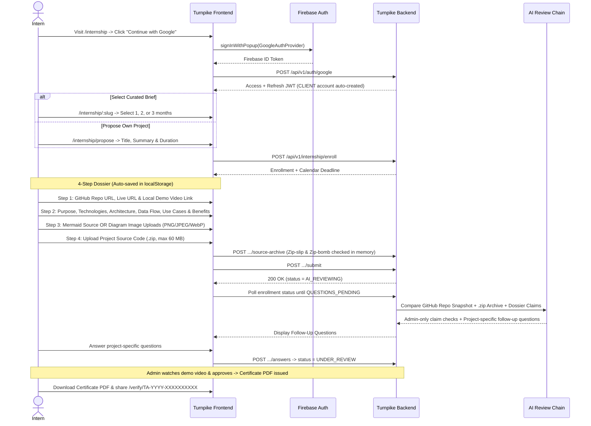

# Turnpike Frontend — Public Website & Intern Portal

> **SSR marketing platform, grounded AI support assistant, public certificate verification, and full-lifecycle internship portal.**  
> Built with **React 19**, **TanStack Start**, **TanStack Router**, **Tailwind CSS v4**, and **Firebase Auth**, deployed to **Vercel** (`Root Directory: turnpike-frontend`).

> **Full System Design (All Actors, Backend, Admin & Data Flows):** [ARCHITECTURE.md](./ARCHITECTURE.md)  
> **Deployment Runbook:** [DEPLOYMENT.md](./DEPLOYMENT.md)

---

## Repository Layout

```text
├── turnpike-frontend/                 # App root (Vercel Root Directory)
│   ├── src/
│   │   ├── routes/
│   │   │   ├── __root.tsx             # HTML shell, webfonts, QueryClient, Sonner Toaster
│   │   │   ├── _site.tsx              # Sticky SiteHeader, AuroraBackground, SiteFooter, SupportChat
│   │   │   └── _site/                 # 22 public & intern pages
│   │   ├── components/
│   │   │   ├── site/                  # Header, MegaMenu, Hero, ServicesExplorer, SupportChat, WaveDivider
│   │   │   ├── internship/            # 4-step DossierForm, SubmissionSummary, GoogleSignInButton
│   │   │   └── shared/                # BookCallDialog
│   │   ├── content/                   # Static marketing copy & technical service catalogs
│   │   ├── server.ts · start.ts · router.tsx
│   │   ├── styles.css                 # Tailwind v4 entry (@source self + shared)
│   │   └── vercel.json                # Nitro Vercel build + security headers
└── packages/shared/                   # @turnpike/shared (47 Radix UI primitives, Axios, Zustand, Tokens)
```

---

## What Users Can See & Do (Visitor, Employer & Intern Flows)



---

## End-to-End Intern Journey & Dual-Source Verification Flow



---

## Complete Route Map (22 Pages)

| Route Path | Rendering | Actor | Purpose |
|---|---|---|---|
| `/` | SSR | Visitor | Hero, metrics, services explorer, tech stack, featured articles |
| `/services` & `/services/$slug` | SSR | Visitor | 15+ consultancy service categories & sub-service specifications |
| `/industries/$slug` | SSR | Visitor | Industry solutions & client case groupings |
| `/software-support` | SSR | Visitor | Managed enterprise software support & SLAs |
| `/training` & `/training/$slug` | SSR | Visitor | Enterprise ECM, OpenShift, Cloud DevOps & AI/ML courses |
| `/blog`, `/blog/$slug`, `/blog-posts`, `/blog-posts/$slug` | SSR | Visitor | Technical articles & insights |
| `/about`, `/our-clients`, `/career`, `/faq`, `/contact` | SSR | Visitor | Company overview, global partners, careers, FAQs, lead capture |
| `/verify/$certificateNumber` | SSR | Employer | Public certificate verification without login |
| `/internship` | SSR | Visitor / Intern | Internship programme overview & published project briefs |
| `/internship/$slug` | SSR | Intern | Brief requirements & 1 / 2 / 3 month enrollment |
| `/internship/propose` | Client | Intern (`CLIENT`) | Propose custom internship project |
| `/internship/dashboard` | Client (`ssr: false`) | Intern (`CLIENT`) | Personal projects, status tracking & certificates |
| `/internship/dashboard/$enrollmentId` | Client (`ssr: false`) | Intern (Owner) | 4-step dossier wizard, `.zip` upload, AI Q&A & PDF download |

---

## Technologies Used in Turnpike Frontend

| Category | Technologies & Libraries |
|---|---|
| **Framework & Routing** | React 19 (`react` 19.2), TanStack Start (`@tanstack/react-start`), TanStack Router (`@tanstack/react-router`), Nitro (`vercel` preset) |
| **Build & Tooling** | Vite 8, TypeScript 5.8, Bun Workspaces (`@turnpike/shared`), ESLint 9, Prettier 3 |
| **Styling & Design System** | Tailwind CSS v4 (`@tailwindcss/vite`, `@tailwindcss/typography`), `tw-animate-css`, shared `oklch` CSS tokens (light & dark) |
| **UI & Motion** | 47 Radix UI primitives (`shadcn`), Lucide React, Motion (`motion` 12), GSAP, Lenis smooth scroll, Embla Carousel, Sonner |
| **Diagrams & Content** | Mermaid (`mermaid` 12.3) live architecture/data-flow preview, `react-markdown`, `rehype-raw` |
| **State, Forms & API** | TanStack React Query v5, Zustand v5 (persisted auth store), React Hook Form, Zod, Axios (with silent JWT refresh) |
| **Authentication** | Firebase Web SDK v12 (`signInWithPopup` Google OAuth -> exchanged for backend JWTs) |

---

## Local Development

```bash
bun install
cp turnpike-frontend/.env.example turnpike-frontend/.env   # set VITE_API_BASE_URL=http://127.0.0.1:8000
bun run dev                                                # http://localhost:3000
```

### Environment Variables (`turnpike-frontend/.env`)

| Variable | Required | Description |
|---|---|---|
| `VITE_API_BASE_URL` | Yes | Backend API base URL (no trailing slash) |
| `VITE_FIREBASE_*` | Optional | Overrides default Firebase Web Config in `packages/shared/src/lib/firebase.ts` |

## Production Deployment (Vercel)

- **Root Directory:** `turnpike-frontend`
- **Build Command:** Managed by `turnpike-frontend/vercel.json` (`cd .. && bun install && cd turnpike-frontend && NITRO_PRESET=vercel bun run build`)
- **Security Headers:** `X-Content-Type-Options: nosniff`, `Referrer-Policy: strict-origin-when-cross-origin`, `X-Frame-Options: SAMEORIGIN`, `Permissions-Policy`.

---

*Published from the Turnpike Analyst monorepo. See [ARCHITECTURE.md](./ARCHITECTURE.md) for the complete platform blueprint.*
